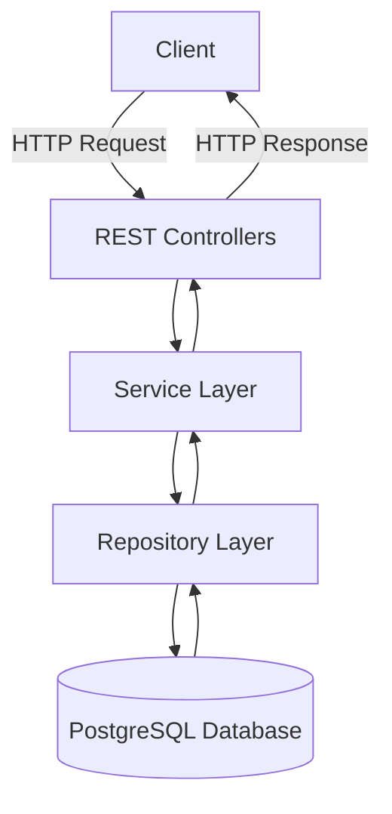

# ClearLedger — Financial Ledger & Reconciliation Platform

A financial ledger and reconciliation backend built with **Java, Spring Boot, and PostgreSQL**, demonstrating REST API development, reliable transaction processing, double-entry bookkeeping concepts, and financial discrepancy detection.

## Overview

ClearLedger is a backend application designed to model core financial operations and help identify inconsistencies between internally recorded transactions and external settlement records.

The project focuses on organizing financial operations through a layered backend architecture, maintaining ledger records, and validating transaction consistency.

### Key Features

- **REST APIs:** Expose backend operations through HTTP endpoints.
- **Financial transaction processing:** Model money movement between accounts.
- **Ledger management:** Maintain records of financial activity.
- **Double-entry bookkeeping:** Represent a transfer using corresponding debit and credit ledger entries.
- **Reconciliation:** Compare internal transaction records with external settlement data to identify discrepancies.
- **Audit history:** Maintain a history of relevant financial operations.
- **Database migrations:** Use Flyway to manage database schema changes.
- **Automated testing:** Validate application behavior using automated tests.
- **Containerization:** Include Docker configuration to support application setup and deployment workflows.

## Why ClearLedger?

Financial systems need more than APIs that update a balance. They must preserve consistency, handle failures safely, and make discrepancies easier to investigate.

ClearLedger explores these challenges through a backend application that separates business logic from HTTP handling and database access.

The project demonstrates foundational backend engineering concepts relevant to fintech, banking systems, and financial services applications.

## Technology Stack

| Technology | Purpose |
|---|---|
| Java | Core application language |
| Spring Boot | Backend application framework |
| Spring Web | REST API development |
| Spring Data JPA | Database access and persistence |
| Hibernate | Object-relational mapping |
| PostgreSQL | Relational database |
| Flyway | Database schema migrations |
| Maven | Dependency management and build automation |
| Docker | Containerization |
| JUnit and project test dependencies | Automated testing |

## Architecture

ClearLedger follows a layered backend architecture. Each layer has a distinct responsibility, making the application easier to maintain, test, and extend.



### Layer Responsibilities

**1. Controller Layer**
- Receives HTTP requests.
- Maps requests to application operations.
- Returns appropriate HTTP responses.

**2. Service Layer**
- Implements business rules.
- Coordinates financial operations.
- Connects API requests with persistence operations.

**3. Repository Layer**
- Handles database access.
- Uses Spring Data JPA for persistence operations.

**4. Domain Layer**
- Represents the application's core entities and business concepts.

**5. DTO and Mapper Layers**
- DTOs define the data exchanged through API requests and responses.
- Mappers help translate between external data structures and internal objects.

**6. Database Layer**
- PostgreSQL stores persistent application data.
- Flyway manages versioned database schema migrations.

## Core Financial Concepts

### 1. Ledger Entries

A ledger entry records an individual financial movement. Rather than treating a transfer as only a balance update, a ledger-based design records the corresponding financial activity.

### 2. Double-Entry Bookkeeping

A transfer between two accounts is represented by two corresponding ledger entries:

| Entry | Account | Effect |
|---|---|---|
| Debit | Source account | Decreases the source balance |
| Credit | Destination account | Increases the destination balance |

For a simple transfer without fees, both entries represent the same amount.

This provides a clearer record of where money leaves and where it goes.

### 3. Transaction Atomicity

A financial operation may involve multiple database changes. Those changes should be treated as one logical unit.

For example, a transfer should not leave the source account debited while the destination account remains uncredited.

Database transaction management helps ensure that the operation commits as a whole or rolls back when an error occurs, subject to the transaction boundaries and implementation.

### 4. Reconciliation

Reconciliation compares internal financial records with external settlement records.

It helps identify situations such as:

- A transaction recorded internally but missing from settlement data.
- A settlement record without a matching internal transaction.
- A difference between the expected and reported transaction amounts.

The purpose is to identify inconsistencies that require investigation.

### 5. Audit History

Financial operations need traceability. An audit history helps developers and investigators understand which operations occurred and examine relevant records when discrepancies arise.

An audit history alone does not guarantee tamper-proof storage; that requires additional controls.

## Database and Persistence

ClearLedger uses PostgreSQL for persistent storage and Spring Data JPA with Hibernate for object-relational mapping.

The persistence layer allows Java application objects to be stored and retrieved as relational data.

Flyway migrations provide a versioned way to apply database schema changes as the application evolves.

Key database concepts relevant to the project include:

- Primary keys and relationships.
- Entity-to-table mapping.
- Data integrity constraints.
- Transaction boundaries.
- Schema versioning and migrations.

## Project Structure

The main application code is organized under `src/main/java/com/clearledger/`.

```text
clearledger/
├── .mvn/
├── src/
│   ├── main/
│   │   ├── java/com/clearledger/
│   │   │   ├── config/
│   │   │   ├── controller/
│   │   │   ├── domain/
│   │   │   ├── dto/
│   │   │   ├── exception/
│   │   │   ├── mapper/
│   │   │   ├── repository/
│   │   │   ├── service/
│   │   │   ├── util/
│   │   │   └── ClearLedgerApplication.java
│   │   └── resources/
│   │       ├── application.properties
│   │       ├── db/migration/
│   │       └── static/
│   └── test/
├── Dockerfile
├── docker-compose.yml
├── mvnw
├── pom.xml
├── render.yaml
└── README.md
```

*Note: The tree highlights the main project structure; individual files and subdirectories may vary.*

## API

ClearLedger exposes backend functionality through REST APIs.

The controller layer handles incoming HTTP requests, while the service layer executes the corresponding business logic and the repository layer interacts with the database.

For the exact endpoints, request fields, response formats, and HTTP status codes, refer to the controller classes and DTOs in the source code.

When documenting or testing an endpoint, include:

- HTTP method and route.
- Required request headers.
- Request body, if applicable.
- Successful response and status code.
- Validation and error responses.

## Testing

Automated tests help verify that the application behaves as expected and that changes do not break previously tested functionality.

The project has reported **49 passing tests**.

To run the test suite using the Maven Wrapper, execute the following command from the project root:

```bash
./mvnw test
```

On Windows, use:

```powershell
.\mvnw.cmd test
```

The reported test count is a snapshot of the test suite, not a guarantee that every possible scenario is covered or that the application is free of defects.

## Running Locally

### Prerequisites

- A compatible Java Development Kit (JDK).
- Docker and Docker Compose, if using the container-based setup.
- Access to the PostgreSQL database configuration required by the application.

### 1. Clone the Repository

```bash
git clone https://github.com/kopalkhare2/clearledger.git
cd clearledger
```

### 2. Configure the Database

Review `src/main/resources/application.properties` and the Docker Compose configuration.

Configure the PostgreSQL connection settings required by the application. Use local development credentials and avoid committing passwords, tokens, or other secrets to the repository.

### 3. Start the Application

If the database and required configuration are ready, run the application using the Maven Wrapper:

```bash
./mvnw spring-boot:run
```

Alternatively, inspect `docker-compose.yml` for the services and startup configuration provided by the project.

### 4. Run the Tests

```bash
./mvnw test
```

**Important:** The commands above assume that the required JDK, database configuration, and other application prerequisites are available. Consult the project configuration for the exact port, credentials, profiles, and container startup procedure.

## Engineering Concepts Demonstrated

ClearLedger provides a practical context for understanding:

- Layered architecture and separation of concerns.
- REST API design.
- Dependency injection in Spring Boot.
- JPA and Hibernate persistence.
- Relational database design.
- Financial ledger fundamentals.
- Double-entry bookkeeping.
- Database transaction consistency.
- Reconciliation and discrepancy detection.
- Database migration management.
- Automated testing and maintainable backend code.

## Limitations and Future Improvements

The project is a learning and portfolio implementation of financial backend concepts. It should not be considered production-ready banking infrastructure solely on the basis of its feature set or passing tests.

Potential areas for further development and validation include:

- Strong authentication, authorization, and account-level access controls.
- Concurrency testing under simultaneous financial operations.
- Robust idempotency guarantees for retried requests, where implemented.
- More extensive reconciliation and failure-recovery scenarios.
- Stronger audit-log integrity and access controls.
- API documentation with concrete request and response examples.
- Monitoring, structured logging, and operational alerting.
- Security testing and deployment hardening.

These are areas for evaluation and improvement, not claims that every capability is already implemented.

## Author

**Kopal Khare**

GitHub: [@kopalkhare2](https://github.com/kopalkhare2)

---
